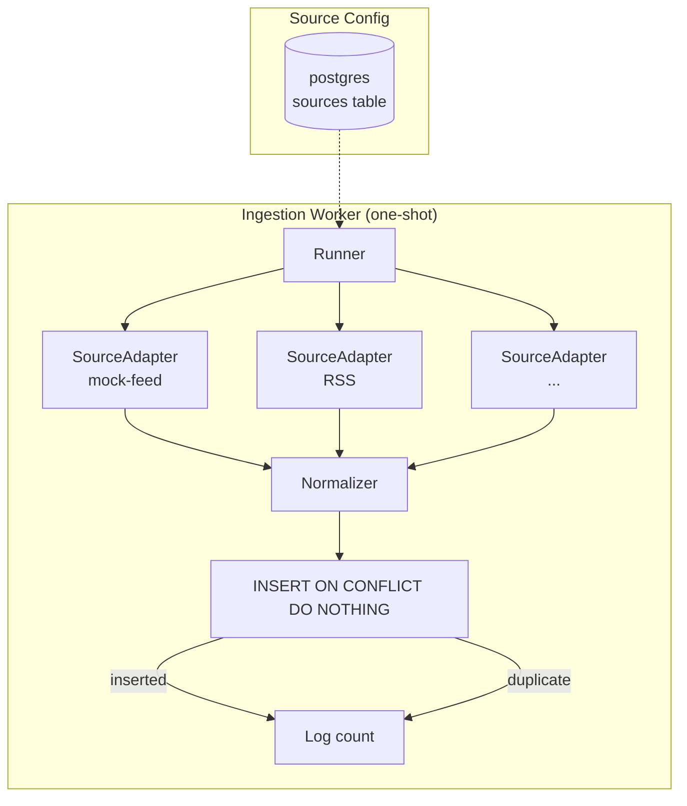
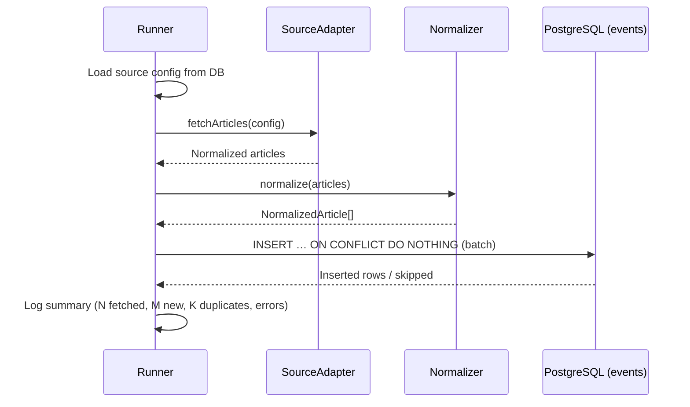

# Ingestion Worker - Architecture

## Overview

One-shot Node.js service that polls external API sources, normalizes articles, deduplicates against PostgreSQL, and persists events (with `location = NULL`). Pure I/O orchestration — no heavy computation. Triggered as a Serverless Job at 06:00 UTC. Location enrichment is handled by a separate job (LES at 07:00 UTC).

## Goals

- Fetch articles from multiple external sources
- Normalize articles to standard shape
- Deduplicate via `(source, source_id)` unique constraint + content hash fallback (see ADR-012)
- Persist events to PostgreSQL with `location = NULL`
- Fail gracefully: per-source retry with backoff, skip mode
- Self-healing: no persistent state, next cycle retries failures

## Module Architecture



## File Structure

```
backend/ingestion-worker/
├── src/
│   ├── index.ts            # Entry point: load sources, run all, exit
│   ├── runner.ts           # Per-source run: fetch → normalize → insert
│   ├── sources/
│   │   ├── adapter.ts      # Abstract adapter interface / type defs
│   │   ├── mock-feed.ts    # Adapter: fetch mock-feed, return normalized articles
│   │   └── registry.ts     # Adapter lookup by source type
│   ├── normalizer.ts       # Adapter output → {source_id, title, description, url, published_at}
│   ├── db.ts               # pg client pool, INSERT ON CONFLICT queries
│   ├── config.ts           # Source config loader: read sources table from PostgreSQL
│   └── logger.ts           # Structured JSON logger (pino)
├── tests/
│   ├── helpers.ts          # Shared: parameterized pool/migration helpers
│   ├── unit/
│   │   ├── normalizer.test.ts
│   │   ├── runner.test.ts
│   │   └── index.test.ts
│   ├── integration/
│   │   ├── setup.ts        # withPostgres() — Testcontainers PostGIS container
│   │   ├── helpers.ts      # Service URLs from environment
│   │   ├── mock-feed.test.ts
│   │   ├── db.test.ts
│   │   ├── config.test.ts
│   │   └── full-cycle.test.ts
│   └── integration-runner.ts  # Testcontainers orchestration (mock-feed + postgres)
├── tsconfig.json
├── package.json
└── AGENTS.md
```

## Source Adapter Contract

Each adapter in `src/sources/*` exports a single async function:

```ts
interface SourceConfig {
  url: string;
  source: string;
  // adapter-specific options
}

interface NormalizedArticle {
  source_id: string;
  title: string;
  description?: string;
  url: string;
  published_at: string;
  source: string;
}

async function fetchArticles(
  config: SourceConfig,
): Promise<NormalizedArticle[]>;
```

- `source_id`: extracted from external ID, or computed SHA-256(title + published_at)
- `title`, `description`: article text (used for later location extraction by LES)
- `url`: permalink
- `published_at`: ISO 8601 string

## Per-Source Run Flow



## Scheduling

The job is triggered externally by a CRON trigger (06:00 UTC on Scaleway). When started:

1. Reads all enabled sources from the `sources` table
2. Runs all sources concurrently via `Promise.allSettled`
3. Logs results and exits

No in-process scheduler or daemon — the process runs once and terminates.

## Error Handling

| Scenario           | Behavior                                                                                                     |
| ------------------ | ------------------------------------------------------------------------------------------------------------ |
| Source fetch fails | Retry with exponential backoff (3 attempts, 1s/4s/16s). If all fail, log error, skip source, continue others |
| DB write fails     | Log error, abort current source run (partial write acceptable for MVP)                                       |
| Job crash          | No recovery state needed. Next run re-processes all sources (dedup prevents duplicates)                      |

## Technology Stack

| Component   | Technology                                  | Rationale                                           |
| ----------- | ------------------------------------------- | --------------------------------------------------- |
| Runtime     | Node.js (with `--experimental-strip-types`) | Pure I/O orchestration, consistent with serving API |
| Language    | TypeScript                                  | Module contracts enforced at compile time (ADR-015) |
| HTTP client | `undici` (built-in fetch)                   | No external dep, Node.js native                     |
| Database    | `pg` (node-postgres)                        | PostgreSQL client, pool management                  |
| Logging     | `pino`                                      | Structured JSON, low overhead, Docker-friendly      |
| XML parsing | `fast-xml-parser`                           | RSS feed parsing (for RSS adapter)                  |
| Testing     | Node built-in `node:test` + `node:assert`   | Zero-dependency test runner                         |

## Environment Variables

| Variable       | Default | Description                  |
| -------------- | ------- | ---------------------------- |
| `DATABASE_URL` | —       | PostgreSQL connection string |
| `LOG_LEVEL`    | `info`  | Pino log level               |

## Performance Targets

| Metric             | Target    | Notes                                       |
| ------------------ | --------- | ------------------------------------------- |
| Articles per cycle | Unlimited | Depends on source. Batch INSERT (100/batch) |
| Cycle duration     | <5 min    | Bounded by source fetch + DB write          |
| Memory             | <200MB    | No heavy deps, pure I/O                     |

## Key Design Decisions

| Decision             | Choice                          | Rationale                                           |
| -------------------- | ------------------------------- | --------------------------------------------------- |
| Language             | TypeScript                      | Module contracts enforced at compile time (ADR-015) |
| One-shot design      | Run once and exit               | Simpler than daemon, no cron library needed         |
| Source config in DB  | sources table                   | Dynamic source registration without restart         |
| Abstract adapter     | async function contract         | Each source: same shape, swap via config row        |
| PostgreSQL dedup     | ON CONFLICT DO NOTHING          | Atomic, no race window (ADR-012)                    |
| Structured logging   | pino                            | Production-ready, docker log processing             |
| Retry per source     | Exponential backoff, 3 attempts | Transient failures recover within same cycle        |
| Decoupled enrichment | LES is separate job             | Independent scaling, simpler error isolation        |

## Docker

```dockerfile
FROM node:22-alpine
WORKDIR /app
COPY package*.json ./
RUN npm ci --only=production
COPY src/ ./src/
CMD ["node", "--experimental-strip-types", "src/index.ts"]
```

## Implementation Phases

### Phase 1: Core Worker (MVP)

- [x] Project scaffolding (package.json, src/, tests/)
- [x] `config.ts` — read sources from PostgreSQL
- [x] `sources/adapter.ts` — normalizer contract + types
- [x] `sources/mock-feed.ts` — fetch mock-feed RSS, parse, normalize
- [x] `db.ts` — pg pool, INSERT ON CONFLICT
- [x] `runner.ts` — orchestrate per-source cycle
- [x] `logger.ts` — pino structured logging
- [x] `index.ts` — entry point, run all and exit
- [x] Dockerfile
- [x] Unit tests for each module
- [x] Integration test: full mock-feed cycle

### Phase 2: Production Sources

- [ ] `sources/rss.ts` — generic RSS adapter
- [ ] Source config migration (sources table)
- [ ] Add real news feed source

### Phase 3: Hardening

- [ ] Graceful shutdown (SIGTERM handler, drain in-flight)
- [ ] Metrics exposure (prometheus client)
- [ ] Alerting on repeated source failures
