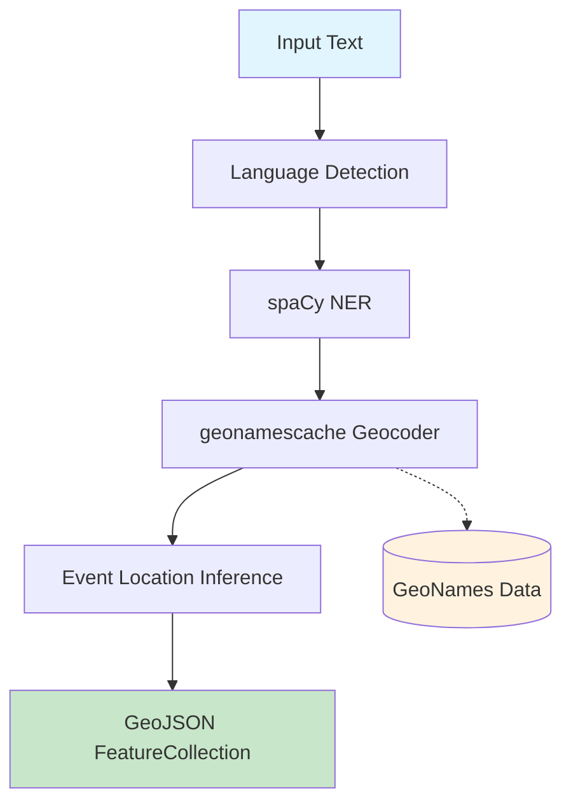

# Location Extraction Service - Architecture

## Overview

A batch NLP job that extracts geographic locations from unprocessed event text (news articles). Runs as a one-shot Serverless Job triggered daily at 07:00 UTC. Designed for processing 500+ articles per run with sub-second latency per article, global coverage, and zero API costs.

## How It Works

```
Cron 07:00 → triggers les-job → connect to DB → SELECT events WHERE location IS NULL LIMIT 500
    → for each event: run NER pipeline → geocode entities → disambiguate → UPDATE location
    → exit
```

The job is **stateless and idempotent** — it only processes events with `location = NULL`, so re-runs skip already-enriched events.

## Pipeline Architecture

The core pipeline is unchanged from its original design as a FastAPI service. The pipeline stages were extracted into a reusable library that the batch entry point (`app.py`) imports directly.



## Module Boundaries & Responsibilities

| Module                              | Input                              | Output                                                    | Complexity Hidden                                                                                                                                     |
| ----------------------------------- | ---------------------------------- | --------------------------------------------------------- | ----------------------------------------------------------------------------------------------------------------------------------------------------- |
| **NerPipeline** (stages 1-2)        | Raw text                           | `NerResult` (language, entity mentions with char offsets) | Language detection, spaCy model selection/caching (seed=0 for determinism), NER extraction, fallback to English on failure                            |
| **GeoPipeline** (stage 3)           | List of `EntityMention`            | `GeoResult` (geocoded locations, failures)                | Offline GeoNames index building, case-insensitive name + alternate-name matching, population-based disambiguation, injectable `geocode_fn` test seam  |
| **DisambiguatePipeline** (stage 4)  | Geocoded locations + original text | `DisambiguateResult` (best event location, all scored)    | Position scoring (earlier = higher), entity type weighting (GPE 2.5× vs LOC 1.0×), preposition-context boost ("in/at/near"), confidence normalization |
| **LocationPipeline** (orchestrator) | Raw text                           | `LocationResult` (merged result with timing diagnostics)  | Stage sequencing, merging geocoding results back to NER entities, performance timing; all sub-pipelines injectable for testing                        |

## Batch Entry Point

`src/app.py` — the sole entry point (no HTTP server):

```
run_batch(connection, pipeline)
  → SELECT id, title, description FROM events WHERE location IS NULL LIMIT 500
  → for each row: pipeline.run(text) → UPDATE location = ST_SetSRID(ST_MakePoint(lon, lat), 4326)
  → commit, return count
```

The batch size (500) prevents long-running transactions. The job can be safely re-run — already-processed events are skipped via the `location IS NULL` filter.

## Technology Stack

| Component          | Technology                 | Rationale                                          |
| ------------------ | -------------------------- | -------------------------------------------------- |
| Runtime            | Python 3.14                | spaCy ecosystem, psycopg2 DB driver                |
| Language Detection | langdetect                 | Lightweight, seed=0 for determinism                |
| NER                | spaCy + en/fr_core_news_sm | Industry standard, ~10MB models, good MVP accuracy |
| Geocoder           | geonamescache (3.0.1)      | Offline, GeoNames data bundled with pip package    |
| Country lookup     | pycountry                  | ISO code → country name resolution                 |
| DB Driver          | psycopg2                   | PostgreSQL adapter, production-ready               |

## Key Design Decisions

| Decision       | Choice                           | Rationale                                                                                               |
| -------------- | -------------------------------- | ------------------------------------------------------------------------------------------------------- |
| Geocoding      | geonamescache (offline)          | Zero API costs, fully offline, 200K+ cities with alternate name matching (per ADR-007)                  |
| Architecture   | Injectable sub-pipelines         | Each pipeline stage accepts optional constructor injection for isolated unit testing                    |
| Interface      | Typed dataclasses between stages | Not raw dicts — each pipeline stage has explicit input/output records (per ADR-006)                     |
| Disambiguation | Weighted scoring (not ML)        | Simple heuristics — position, type, preposition context — sufficient for MVP, no training data required |
| NER Models     | Small spaCy models (~10MB)       | Fast loading, low memory; trivially swapped for larger models if accuracy requires                      |
| Job Design     | One-shot batch (no daemon)       | No HTTP server, no scheduler — exits after processing. Simpler, cheaper on serverless                   |

## Performance Targets

| Metric        | Target        | Notes                               |
| ------------- | ------------- | ----------------------------------- |
| Throughput    | 500+ docs/run | LIMIT 500 per batch                 |
| Latency (p95) | <1 second     | Per document                        |
| Memory        | ~2GB          | spaCy models + geocoder index       |
| Accuracy      | >85%          | Correct location for clear mentions |

## Constraints & Assumptions

- Limited to EN and FR languages for MVP; adding languages requires a spaCy model and a `_MODEL_MAP` entry
- Population-based geocoding disambiguation assumes the most populous match is correct, which may fail for low-population places sharing names with famous cities
- Language detection defaults to English on failure or empty input
- spaCy small models trade NER accuracy for startup speed and memory; upgrade path to larger models exists
- The ingestion worker and LES are decoupled — ingestion INSERTs events with `location = NULL`, LES picks them up on the next run

## Evaluation Module

Quality evaluation covers NER (stages 1-2) and geocoding + event location (stages 3-4). See the [Evaluation Guide](../evaluation.md).

## References

- [ADR-003: NER Pipeline Seam](../decisions/ADR-003-ner-pipeline-seam.md)
- [ADR-006: Pipeline Architectural Improvements](../decisions/ADR-006-pipeline-architectural-improvements.md)
- [ADR-007: Replace text2geo with geonamescache](../decisions/ADR-007-replace-text2geo-with-geonamescache.md)
- [spaCy](https://spacy.io/), [geonamescache](https://pypi.org/project/geonamescache/), [GeoNames](https://www.geonames.org/)
