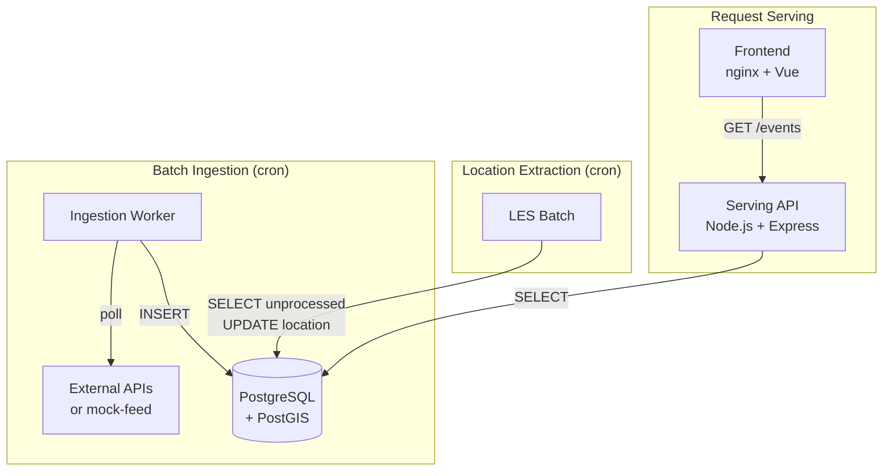
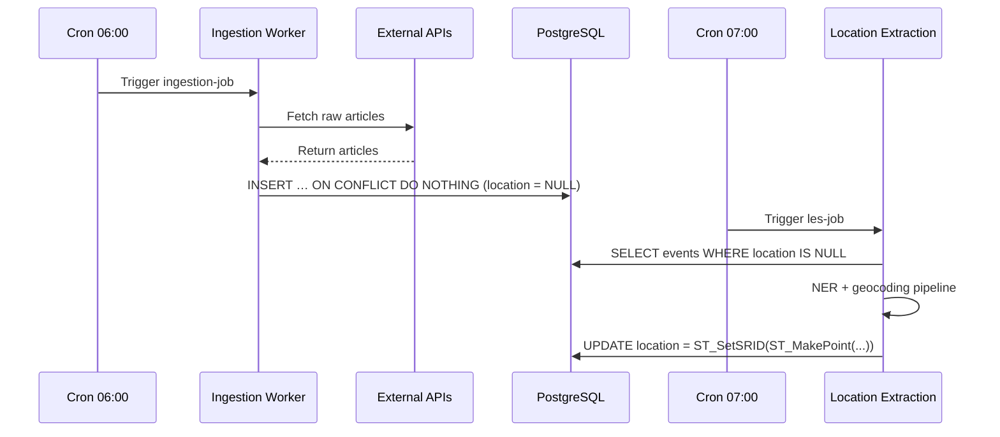
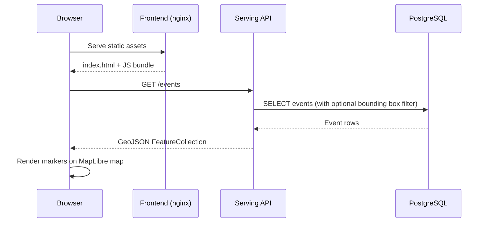

# Living Map - Architecture Overview

## Overview

A real-time web application displaying geographical events on an interactive map. Designed for mobile-first viewing with public, read-only access.

## Technology Stack

| Layer               | Technology                     | Notes                                                  |
| ------------------- | ------------------------------ | ------------------------------------------------------ |
| Frontend            | Vue 3 + Vite                   | Lightweight, mobile-optimized                          |
| Map                 | MapLibre GL JS                 | Open-source, OSM tiles                                 |
| State Management    | Pinia                          | Official Vue recommendation                            |
| Serving API         | Node.js + TypeScript + Express | Read-only API, reads from PostgreSQL                   |
| Ingestion Worker    | Node.js + TypeScript           | Cron-triggered batch ingestion from external APIs      |
| Location Extraction | Python (batch script)          | NER + geocoding pipeline for enriching event locations |
| Database            | PostgreSQL + PostGIS           | Geospatial persistence, spatial indexes                |
| External Data       | External APIs                  | Real news/event feeds (mock-feed for testing)          |

## High-Level Architecture



**Note**: `mock-feed` (port 3001) provides test data for local development and integration tests (via Testcontainers), but is NOT part of the default docker-compose stack. Location Extraction is detailed in [location-extraction.md](./location-extraction.md). Run all services with `docker compose -f backend/docker-compose.yml up --build` from the repo root.

## Repository Structure

```
.
├── frontend/                     # Vue 3 + Vite + MapLibre GL JS
│   ├── src/
│   │   ├── components/           # Reusable UI components
│   │   ├── stores/               # Pinia stores
│   │   ├── services/             # API client
│   │   └── assets/               # Styles
│   ├── Dockerfile                # Multi-stage: build + nginx serving
│   └── package.json
├── backend/
│   ├── api/                      # Serving API (Express)
│   │   ├── src/
│   │   │   ├── routes/           # GET /events, etc.
│   │   │   ├── services/         # External integrations
│   │   │   ├── db/               # PostgreSQL client + queries
│   │   │   └── utils/            # Helpers
│   │   ├── Dockerfile
│   │   └── package.json
│   ├── ingestion-worker/         # Node.js + TypeScript batch ingestion
│   │   ├── src/
│   │   │   ├── index.ts          # Entry point (one-shot, all sources)
│   │   │   ├── sources/          # Source adapters (mock-feed, RSS, …)
│   │   │   ├── runner.ts         # Per-source fetch → insert cycle
│   │   │   ├── normalizer.ts     # Article normalization
│   │   │   ├── db.ts             # INSERT/UPDATE queries
│   │   │   ├── config.ts         # Source config loader
│   │   │   └── logger.ts         # Structured JSON logger
│   │   ├── Dockerfile
│   │   └── package.json
│   ├── mock-feed/                # Mock RSS feed for testing (standalone)
│   │   ├── src/
│   │   │   ├── routes/           # /feed endpoint
│   │   │   └── utils/            # Generator, RSS builder
│   │   ├── Dockerfile
│   │   └── package.json
│   ├── location-extraction-service/  # Python NLP batch job
│   │   ├── src/                  # NER + geocoding pipeline
│   │   ├── Dockerfile
│   │   └── pyproject.toml
│   ├── migrations/               # DB schema migrations (node-pg-migrate)
│   └── docker-compose.yml        # Services: postgres, migrate, api, frontend
├── docs/                         # Architecture docs, ADRs, glossary
├── scripts/                      # Formatting and CI scripts
├── AGENTS.md                     # AI agent instructions
└── README.md
```

## Data Flow

The system has two independent cycles:

### Ingestion Cycle (two decoupled batch jobs)



1. **06:00 UTC** — CRON triggers `ingestion-job`: fetches articles from external APIs/mock-feed, deduplicates via `ON CONFLICT DO NOTHING`, inserts new events with `location = NULL`
2. **07:00 UTC** — CRON triggers `les-job`: queries unprocessed events, runs spaCy NER + geonamescache geocoding, updates event locations
3. The two jobs are **decoupled** — they communicate only through the database

### Serving Cycle (request-response)



1. Browser loads frontend static assets via nginx (or Vite dev server)
2. Frontend requests events via GET /events (with optional bounding box)
3. Serving API queries PostgreSQL for matching events
4. API returns GeoJSON FeatureCollection to frontend
5. Frontend renders markers on MapLibre map

## Key Design Decisions

| Decision            | Choice                     | Rationale                                                     |
| ------------------- | -------------------------- | ------------------------------------------------------------- |
| Map Library         | MapLibre GL JS             | Open-source, no API key, OSM tiles                            |
| Data Freshness      | Batch ingestion (cron)     | Sufficient for news-cycle data, simpler than queue            |
| Persistence         | PostgreSQL + PostGIS       | Geospatial queries, concurrent writes, survives restarts      |
| Ingestion Worker    | Node.js + TypeScript       | Pure I/O orchestration, consistent with serving API (ADR-015) |
| Services            | Separate (ingestion + API) | Independent scaling, failure isolation                        |
| Deduplication       | source_id + content hash   | Handles both stable and unstable source IDs                   |
| Responsive          | Mobile-first CSS           | Essential for mobile-friendly requirement                     |
| Location Extraction | spaCy + geonamescache      | Offline NLP, zero API costs, global coverage                  |

## Constraints & Assumptions

- Public, read-only access (no authentication)
- Small scale (< 1000 concurrent users)
- External API sources: mock-feed (RSS) for testing, real feeds to be added later
- Data freshness: batch ingestion runs at configurable per-source intervals
- PostgreSQL + PostGIS: geospatial persistence, spatial indexes for bounding box queries
- Ingestion failure does not affect serving (stale data served until next successful cycle)
